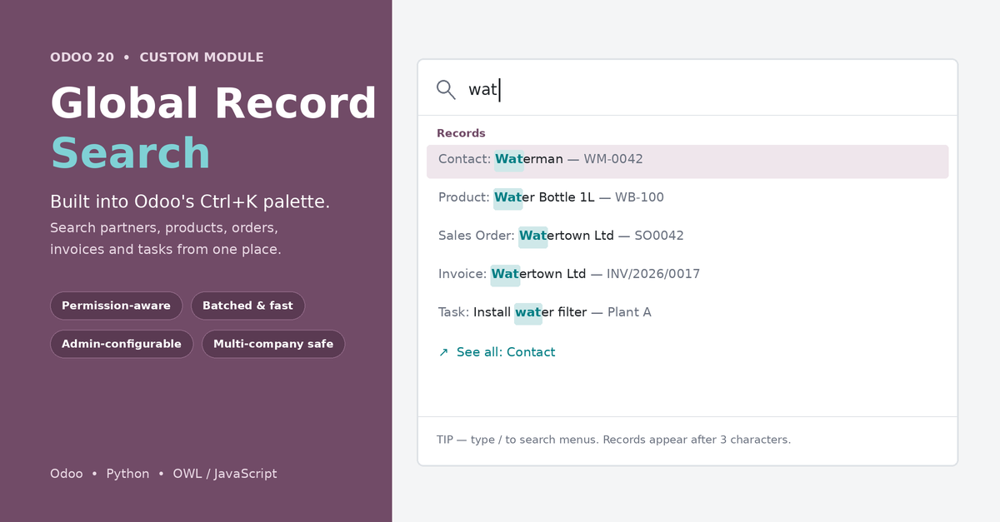

# Global Record Search for Odoo 20

Search every record in Odoo 20 from the built-in **Ctrl+K command palette**.
Type 3 or more characters and results appear under **Records**.

> Requires Odoo 20 Enterprise (`web_enterprise`).

## Features

- Searches every model reachable through a menu the user can access
- Exclude models, add extra search fields and set priority (admin settings)
- Respects user access rights and active company
- Batched search with highlighted matches and "See all" list links

## Installation

1. Copy `global_record_search` into your Odoo addons path.
2. Restart Odoo and update the Apps list.
3. Install **Global Record Search**.

## Configuration

Go to **Settings > Global Search** to exclude models, set priority and add extra search fields.

System parameters: `global_record_search.limit` (default 5) and `global_record_search.min_chars` (default 3).
If you change `min_chars`, update `MIN_CHARS` in `static/src/js/command_palette_provider.js` too.

## Author

**Shuhaife Binhamza** · [LinkedIn](https://www.linkedin.com/in/shuhaife-binhamza/)

